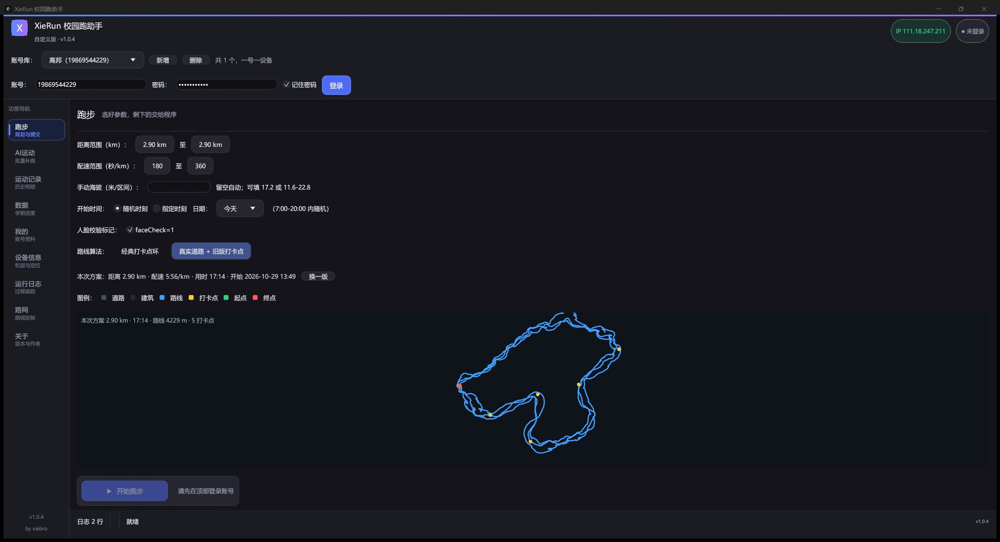

# XieRun 校园跑助手

> 一个把「运动世界校园」跑步流程做成本地图形化工具的小软件：自动生成贴近真实的轨迹、自动过滑块验证、自动提交，省掉手动点手机的时间。
>
> 本项目仅用于**技术研究与个人学习**（Rust GUI、协议分析、轨迹生成算法）。请在符合所在学校规定与平台服务条款的前提下使用，由使用者自行承担后果。



## 功能

| 模块 | 说明 |
| --- | --- |
| 跑步 | 选距离/配速区间，本地生成轨迹（含 GPS 抖动与横向游走），一键提交；支持指定日期补跑 |
| AI 运动 | 对接「AI 体育」类项目记录 |
| 记录 | 拉取学期内全部跑步记录，含无效/申诉状态 |
| 数据 | 学期进度、目标里程、有效次数 |
| 设备 | DeviceId / 机型伪装信息 |
| 路网 | 用打卡点自动成线：目标距离 + 崎岖度滑块 → 闭环路线，可导出 `route.osm` 给跑步页使用；也可手动画线 |
| 日志 / 关于 | 运行日志、版本信息 |

### 轨迹怎么生成的

- 依据打卡点位置，按方位角排序后做**闭合 Catmull-Rom 样条**（严格经过每个打卡点），弧长等距重采样为 2 m 步长；
- 叠加低频径向游走（崎岖度 0–100%，最高 ±8 m）+ 逐点 GPS 抖动，最后做**转角上限 8°的平滑迭代**，兼顾「像人跑」和「不出现折线尖角」；
- 遇到建筑多边形会把点推出去；导出时同时写 `route.osm`（单圈路网）与 `route.outline`（外轮廓），跑步页用轮廓生成路线，避免路网自身多圈导致路线变长。

## 界面

- 深色 Fluent 风格，`egui` 自绘；顶部品牌条 + 左侧导航 + 卡片式内容区；
- 渲染后端 `wgpu`（DX12），1080p 下内存占用稳定在 ~340 MB。

## 构建

需要 Rust（建议 1.90+）与 MSVC 工具链：

```powershell
# 中文路径下 GNU 工具链会链接失败，务必用 MSVC
cargo +1.97.1-x86_64-pc-windows-msvc build --release
# 产物：target\release\XieRun.exe
```

关掉代理再构建（`ureq` 不读系统代理，构建机上的 `HTTP_PROXY` 会干扰）：

```powershell
Remove-Item Env:HTTP_PROXY,Env:HTTPS_PROXY,Env:ALL_PROXY -ErrorAction SilentlyContinue
```

## 运行

Windows 10/11 x64，双击 `XieRun.exe` 即可，绿色免安装。程序数据全部写在 **exe 同目录**：

| 文件 | 内容 |
| --- | --- |
| `accounts.json` | 账号库（含密码，明文，注意保管） |
| `session.json` | 登录会话（token） |
| `identity.json` | 设备指纹与打卡锚点 |
| `config.json` | 界面与跑步参数 |
| `points_cache.json` | 打卡点缓存 |
| `checkpoints.json` | 打卡点库（路网页用） |
| `route.osm` / `route.outline` | 导出的路线数据 |
| `gui.log` | 运行日志（超过 2 MB 自动轮转） |

### 命令行

同一个 exe 也带 CLI（`XieRun.exe <子命令>`）：

```text
login --user <账号> --pass <密码> --remember
accounts / account-use <账号> / account-remove <账号>
run [--dist 3.0] [--pace 330] [--days-ago 1] [--route legacy|road]
run-all / semester / score / records / rank / ai
probe points|fence|policy|zones|gmttime|ai
track-sample / network-build / obs-get / obs-sample / record-info
```

## 常见问题

**登录时卡在验证码 / 图片下载超时**
`static.geetest.com` 的多个 A 记录质量差异极大，可在 `hosts` 里固定一个连通快的：

```text
111.51.158.194 static.geetest.com
```

**提交报 `HTTP 401 Unauthorized`**
token 过期，回顶部点「登录」重新登录一次即可（软件会用新 token 重试）。

**提交报 `10121 账号已在其他设备登录`**
同一账号在另一处（手机 App / 另一份本软件）还挂着会话。服务端会锁约 1 小时，等解锁后只在一处登录。

**路线看着不像操场**
本工具按**打卡点**成线，不是按操场跑道。想跑标准圈：到「路网」页把手动画线打开，沿跑道点几个点生成闭环，导出后跑步页就会用这条圈。

## 目录结构

```text
src/
  api/        协议客户端、登录流程、打卡点/围栏/政策接口
  crypto/     请求体加解密
  track/      轨迹生成（geom / generator / generate_road / auto_route / network / wire）
  ui/         egui 界面（workbench / theme / run / osm / records / data / user / device / about）
crates/
  route-planner/  路网寻路与平滑（图、投影、平滑采样）
vendor/
  winit-0.30.13/  Android 事件循环补丁
```

## 免责声明

本项目与「运动世界校园」及其运营方无任何关联，未获其授权。所有接口均来自公开客户端行为分析，仅供学习 Rust/协议/算法之用。**请勿用于任何违反校规或平台条款的场景**；因使用本工具造成的账号处罚、成绩作废等后果由使用者自负。

## 许可

代码以 CC-BY-NC-4.0 发布（见 `LICENSE`），禁止商用。
